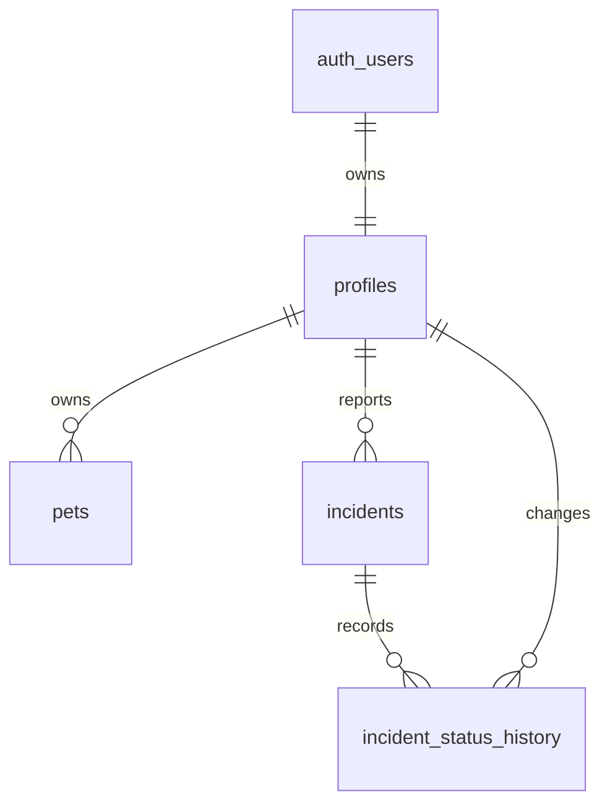

# Modelo de datos

La migración en `supabase/migrations` es la fuente de verdad del esquema. `profiles.role` se asigna como `citizen` al registrarse. Solo un administrador de un proyecto Supabase exclusivo puede promover y asignar distrito a personal municipal.
