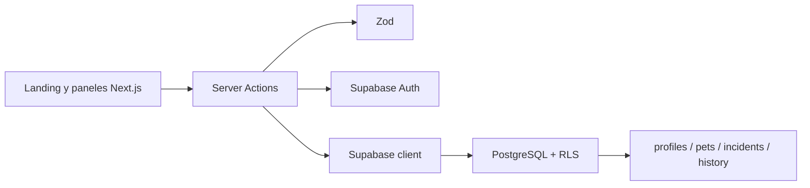

# Arquitectura lógica

Las páginas privadas verifican la sesión con `getUser`. Cada acción vuelve a comprobar el rol en el servidor y valida entradas con Zod. PostgreSQL aplica RLS por usuario y distrito municipal. El registro público crea siempre el rol ciudadano mediante un trigger; los metadatos editables no conceden roles. Los cambios de estado generan una entrada de historial mediante trigger.
